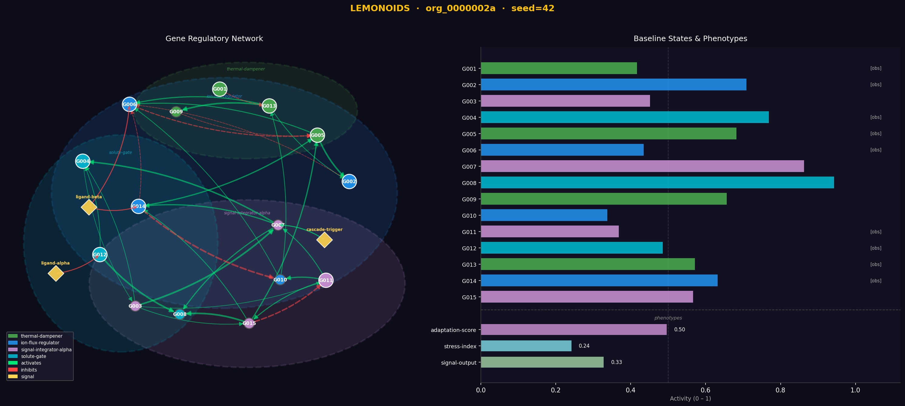

# 🍋 LEMONOIDS

**Synthetic organism reasoning benchmark for LLM agents**

A Python package that procedurally generates synthetic biological organisms (based on synthetic regulatory networks) and exposes them as a reasoning benchmark for LLM agents.

The world is **unknowable via retrieval** — gene names, module labels, signals, and pathways are all invented. Prior biological knowledge is useless. An agent must reason causally from perturbation experiments to succeed.

---

## 🧬 Design Principles

1. **Made-up vocabulary** — gene IDs e.g `G001`, modules labeled `"charge-flow-regulator"`, signals e.g`"substrate-X"`. No real gene or pathway names. Distinguishes causal reasoning from retrieval.
2. **Organism dynamics and complexity** — gene states follow `x_i(t+1) = σ(bias_i + Σ W_ij·x_j + signal_terms + ε)`, values in [0, 1] ([Mjolsness, Sharp & Reinitz, 1991](https://doi.org/10.1016/S0022-5193(05)80391-1); [Karlebach & Shamir, 2008](https://doi.org/10.1038/nrm2503)). Complexity is controlled along four axes:

   | Tier | Alias | Observability | Feedback loops | Latent genes | Noise |
   |------|-------|:---:|:---:|:---:|:---:|
   | `easy` | `prokaryote` | 80 % | 0 | 0 % | 0.005 |
   | `medium` | `simple_eukaryote` | 60 % | 2 | 0 % | 0.01 |
   | `hard` | `complex_eukaryote` | 50 % | 4 | 25 % | 0.03 |

   **`medium` is the default** and defines the canonical benchmark split (seeds 0–19). Observability = fraction of genes visible to the agent; feedback loops = injected recurrent edges; latent genes = hidden confounders never visible or targetable.

3. **Named phenotype readouts** — non-linear summaries of an organism state e.g `"expansion-rate"` depending on gene states. The agent sees readout names and values, not raw gene states.
4. **JSON/YAML serialization** — organisms are fully serializable for reproducibility and offline evaluation.
5. **Disease mode** — organisms can be given a malfunction (LOCK_HI/LOCK_LO/PERSIST) that shifts phenotypes away from healthy ranges. Agents must diagnose and rescue.

---

## 🎯 The Task

LEMONOIDS is a benchmark for causal reasoning under a fixed experimental budget. Each session presents an agent with a freshly generated organism it has never seen — no prior knowledge applies. The agent must design perturbation experiments, build a causal model from the results, and make accurate predictions.

**The agent is given:**
- A set of observable genes and their baseline states
- Named phenotype readouts (not raw gene states)
- A budget of perturbation experiments

**The agent must:**
1. **Explore** — run experiments: BLOCK, BOOST, or DAMPEN genes, or activate signals. Each costs 1 budget unit.

   | Intervention | Effect |
   |---|---|
   | `BLOCK` | Suppress gene to 0.0 |
   | `BOOST` | Saturate gene to 1.0 |
   | `DAMPEN` | Clamp gene to ≤ 0.15 |
   | signal `"activate"` | Amplify signal input to targets |

2. **Predict** — submit phenotype values for 2 held-out intervention combinations not directly measured.
3. **Hypothesise** — submit a free-text causal summary of the network.

**In disease mode**, the agent also:
4. **Diagnose** — identify the malfunctioning gene or signal and its type.
5. **Rescue** — test an intervention that restores phenotypes to healthy ranges.

**Scoring:**

| Component | Metric | Mode |
|-----------|--------|------|
| Prediction accuracy | MSE + fraction within ±0.15 threshold | Both |
| Causal hypothesis | Stored free text — qualitative review | Both |
| Diagnosis | 1.0 exact · 0.5 right target wrong type · 0.0 wrong | Disease |
| Rescue | Fraction of aberrant phenotypes restored to healthy range | Disease |

> Prediction tasks are revealed one at a time — the next task only unlocks after the current one is submitted, preventing direct-measurement gaming. **Random baseline:** prediction MSE ≈ 0.08.

> Modules are **hidden from the agent** — inferring functional groupings is part of the challenge.

---

## ⚡ Quick Start

```bash
pip install -r requirements.txt

# Smoke test
python -c "from lemonoids import generate_organism; o = generate_organism(seed=0); print(o.id)"
```

### demo.py — walkthrough & agent demo

```bash
python demo.py                          # narrative walkthrough (no API key needed)
python demo.py --agent                  # run an agent session; saves logs/demo_agent.{json,html}
python demo.py --agent --model gpt-4.1  # choose model
python demo.py --agent --disease        # disease mode
```

| Flag | Default | Description |
|------|---------|-------------|
| `--agent` | off | Run an LLM agent session after the walkthrough |
| `--model MODEL` | `gpt-4o` | Model to use (e.g. `gpt-4.1`, `claude-opus-4-6`) |
| `--disease` | off | Use a disease organism |

### evaluate.py — benchmark evaluation

Runs the canonical benchmark: seeds 0–19, medium difficulty. Produces aggregate scores (MSE, accuracy, composite) across organisms.

```bash
python evaluate.py --heuristic                              # no API key required
python evaluate.py --model claude-opus-4-6                  # requires ANTHROPIC_API_KEY
python evaluate.py --model gpt-5.1                          # requires OPENAI_API_KEY
python evaluate.py --model claude-opus-4-6 --model gpt-5.1  # compare models
python evaluate.py --model claude-opus-4-6 --disease
python evaluate.py --model claude-opus-4-6 --difficulty hard
```

| Flag | Default | Description |
|------|---------|-------------|
| `--model MODEL` | — | Model to evaluate (repeatable for comparison) |
| `--heuristic` | off | Include the heuristic baseline (BLOCK each gene, predict additively) |
| `--disease` | off | Evaluate in disease mode |
| `--difficulty TIER` | `medium` | `easy` / `medium` / `hard` |
| `--n INT` | 20 | Number of organisms (uses canonical seeds 0…N-1) |
| `--seeds` | — | Override seeds: integers or range, e.g. `0 1 2` or `0:10` |
| `--out DIR` | `results/` | Output directory for JSONL results and logs |

---

## 🔍 Inspector CLI

Visualise and explore individual organisms. Use `evaluate.py` for multi-seed benchmarking; use `--replay` here to run a single agent session and inspect its reasoning in detail.

```bash
# Terminal summary + interactive graph (default: seed=42, medium difficulty)
python inspect_organism.py
python inspect_organism.py --seed 7 --difficulty hard

# Figure only / terminal only
python inspect_organism.py --seed 7 --save org.png --no-show
python inspect_organism.py --no-plot

# Disease organism: terminal comparison + optional side-by-side GRN figure
python inspect_organism.py --disease --seed 7 --no-plot
python inspect_organism.py --disease --compare --seed 7 --no-show --save disease.png

# Single-organism agent session — saves JSON + HTML trace for inspection
# (for multi-seed evaluation use evaluate.py)
python inspect_organism.py --replay --seed 42 --log logs/run.json
python inspect_organism.py --replay --disease --model gpt-4o --seed 42 --log logs/run.json --trace
```

| Flag | Default | Description |
|------|---------|-------------|
| `--seed INT` | 42 | Organism seed |
| `--difficulty TIER` | `medium` | `easy` / `medium` / `hard` |
| `--disease` | off | Disease organism (terminal: healthy vs disease comparison) |
| `--compare` | off | Side-by-side healthy vs disease GRN figure (with `--disease`) |
| `--replay` | off | Run a single agent session for inspection; save JSON + HTML with `--log` |
| `--model MODEL` | `claude-opus-4-6` | Model for `--replay` |
| `--log PATH` | — | Save agent session log to JSON and generate HTML report |
| `--trace` | off | Print turn-by-turn trace after replay |
| `--save PATH` | — | Save figure to file |
| `--no-show` | off | Skip interactive plot window |
| `--no-plot` | off | Skip figure entirely |

**Programmatic usage:**
```python
from lemonoids import generate_organism
from lemonoids.inspect import print_organism, plot_organism

org = generate_organism(seed=42)
print_organism(org)                          # terminal
plot_organism(org, save_path="org.png")      # figure
```

---

## 📁 Package Structure

```
lemonoids/
├── __init__.py       # Public API
├── schema.py         # Dataclasses: Gene, Module, Signal, Relation, Phenotype,
│                     #   DynamicsConfig, Organism, CellType, Malfunction
├── vocabulary.py     # Word banks for invented abstract names + cell types
├── generation.py     # generate_organism(), generate_disease_organism()
├── dynamics.py       # simulate_sigmoid(), compute_phenotypes()
├── experiment.py     # ExperimentSession — budget, interventions, scoring
├── dataset.py        # generate_dataset() — JSON export for offline benchmarking
├── agent.py          # Tool definitions + run_agent() (Anthropic + OpenAI)
├── inspect.py        # plot_organism(), plot_disease_organism(), plot_session()
└── report.py         # print_session_trace(), export_session_html()

evaluate.py           # Benchmark evaluation script
demo.py               # Smoke tests + agent demo entry point
inspect_organism.py   # CLI inspector and replay tool
tests/                # pytest suite
requirements.txt
```

---

## 📖 API Reference

### `generate_organism()`

```python
from lemonoids import generate_organism

org = generate_organism(
    n_genes=20,
    n_modules=4,
    n_signals=3,
    n_phenotypes=3,
    difficulty="medium",        # "easy"/"medium"/"hard" or biological aliases
    observability=0.6,          # fraction of genes visible to agent (overrides preset)
    intra_module_density=0.4,   # edge probability within modules
    inter_module_density=0.08,  # edge probability between modules
    inhibition_fraction=0.3,    # fraction of edges that are inhibitory
    n_ffls=2,                   # feed-forward loops to inject
    n_feedback=2,               # feedback edges to inject
    noise_sigma=0.01,
    seed=42,
)
```

Returns an `Organism` with a computed `baseline_state`.

**Serialization:**
```python
json_str = org.to_json()
org2 = Organism.from_json(json_str)

yaml_str = org.to_yaml()
org3 = Organism.from_yaml(yaml_str)
```

---

### `generate_disease_organism()`

```python
from lemonoids import generate_disease_organism

org = generate_disease_organism(
    n_genes=15,
    n_modules=4,
    seed=7,
    # All generate_organism() kwargs are accepted
)
```

Generates a healthy organism, assigns a `CellType`, then applies a malfunction (randomly LOCK_HI, LOCK_LO, or PERSIST on a gene or signal that demonstrably shifts at least one phenotype outside its healthy range). Returns a disease `Organism` whose `baseline_state` is the post-malfunction steady state.

| Malfunction type | Description |
|-----------------|-------------|
| `LOCK_HI` | Node locked high — bias forced high; activity saturates |
| `LOCK_LO` | Node locked low — bias forced low; activity silenced |
| `PERSIST` | A signal permanently active at amplified strength |

Additional fields on a disease `Organism`: `cell_type`, `healthy_baseline`, `healthy_phenotype_ranges`, `malfunctions`.

```python
from lemonoids.inspect import plot_disease_organism

plot_disease_organism(org, save_path="disease.png")
# Paired bars: grey = healthy baseline, coloured = disease state
# Red highlights on phenotypes outside healthy range
```

---

### `ExperimentSession`

```python
from lemonoids import ExperimentSession

session = ExperimentSession(org, seed=0)  # budget defaults to recommended_budget(org)
```

On init, 2 `PredictionTask`s are generated with hidden ground-truth phenotype values. Tasks use cross-module double-gene interventions that are unlikely to have been directly measured.

#### Methods

**`get_info()`** — 🆓 free
```python
info = session.get_info()
# Returns: gene_names, signals, observable_phenotypes, budget, baseline_phenotypes
# Disease organisms also return: cell_type, cell_type_description,
#   healthy_phenotype_ranges, aberrant_phenotypes
```

**`get_next_prediction_task()`** — 🆓 free
```python
task = session.get_next_prediction_task()
# Returns one task at a time:
#   {task_id, interventions, tasks_remaining, note}
# The next task only unlocks after the current one is submitted via submit_prediction().
# Returns {done: True} when all tasks have been submitted.
```

**`run_experiment(interventions)`** — 💸 costs 1 budget unit
```python
result = session.run_experiment({
    "G005": {"type": "BLOCK"},
    "G012": {"type": "BOOST"},
    "substrate-X": "activate",   # signal label
})
# Returns: phenotypes dict, status, steps, budget_remaining
```

**`submit_prediction(task_id, prediction)`** — 🆓 free
```python
score = session.submit_prediction("task_00", {
    "expansion-rate": 0.72,
    "stress-index": 0.45,
})
# Returns: mse, accuracy (fraction within 0.15 threshold), per-phenotype details
```

**`submit_hypothesis(text)`** — 🆓 free
```python
session.submit_hypothesis("G010 appears to be a master regulator of expansion-rate...")
```

**`test_rescue(interventions)`** — 💸 costs 1 budget unit *(disease mode only)*
```python
result = session.test_rescue({"G007": {"type": "BLOCK"}})
# Returns: phenotypes, per-phenotype in_healthy_range flags,
#          restored_fraction, mse_vs_healthy, budget_remaining
```

**`submit_malfunction_hypothesis(target_name, malfunction_type)`** — 🆓 free *(disease mode only)*
```python
result = session.submit_malfunction_hypothesis("G007", "LOCK_HI")
# malfunction_type: "LOCK_HI" | "LOCK_LO" | "PERSIST"
# One submission only — locked immediately. Unlocks test_rescue().
# Returns: {"stored": True, "note": "..."}
# Score (1.0 exact, 0.5 right target wrong type, 0.0 wrong) revealed via get_summary().
```

**`get_summary()`**
```python
summary = session.get_summary()
# Returns: organism_id, budget_total, budget_used, prediction_results,
#          avg_mse, avg_accuracy, hypothesis, n_experiments
# Disease mode also includes: malfunction_hypothesis, rescue_results
```

---

### `run_agent()`

```python
from lemonoids import run_agent

summary = run_agent(
    session,
    model="claude-opus-4-6",   # or "claude-sonnet-4-6", "gpt-5.1", etc.
    max_turns=50,
    verbose=True,
    disease_mode=None,         # None = auto-detect from session
    log_path="logs/run.json",  # optional: save structured JSON log
)
```

Runs an LLM agent against the session using a tool-use harness. Provider is inferred from the model name (`claude-*` → Anthropic, `gpt-*`/`o1`/`o3` → OpenAI). The system prompt frames the vocabulary as synthetic and instructs the model to reason from perturbation data only.

**Tools available to the agent:**

| Tool | Cost | Description |
|------|------|-------------|
| `get_organism_info` | free | Gene list, signals, phenotypes, baseline |
| `get_next_prediction_task` | free | Reveal next prediction task (one at a time) |
| `run_experiment` | 1 budget | Run perturbation, get phenotype readout |
| `submit_prediction` | free | Score prediction for a task |
| `submit_hypothesis` | free | Store free-text causal hypothesis |
| `test_rescue` *(disease)* | 1 budget | Test rescue intervention vs healthy ranges |
| `submit_malfunction_hypothesis` *(disease)* | free | Diagnose malfunction type and target |

**Agent goals (healthy mode):** phenotype prediction → causal hypothesis

**Agent goals (disease mode):** malfunction diagnosis → rescue → phenotype prediction → causal hypothesis

When `log_path` is provided, a structured JSON log is written with per-turn reasoning text and tool call results. An HTML diagnostic report is auto-generated at the same path with `.html` extension when using the inspector CLI.

---

### Diagnostic Reports

```python
from lemonoids.report import print_session_trace, export_session_html
import json

with open("logs/run.json") as f:
    log = json.load(f)

print_session_trace(log)           # human-readable turn-by-turn trace
export_session_html(log, "run.html")  # self-contained dark-theme HTML report
```

**`print_session_trace`** outputs:
- Per-turn reasoning snippet, tool calls with inputs and results
- For `run_experiment`: Δ from baseline per phenotype, health flags (✓/✗/⚠)
- For `test_rescue`: per-phenotype healthy-range check
- Summary section at end

**`export_session_html`** generates:
- Self-contained HTML with dark theme, collapsible turn cards
- Color-coded tool call results (ok / warn / error)
- Summary table at bottom


---

### `generate_dataset()`

```python
from lemonoids import generate_dataset

paths = generate_dataset(
    n_organisms=50,
    experiments_per_organism=10,
    complexity_range={"n_genes": (10, 30), "n_modules": (3, 6)},
    output_path="my_dataset/",
    seed=42,
)
# Writes: my_dataset/organisms.json, my_dataset/experiments.json
```

- 🧬 `organisms.json` — serialized organisms including hidden ground-truth modules
- 🧪 `experiments.json` — `{organism_id, experiment_id, interventions, result}` records

---

## 📦 Dependencies

```
anthropic>=0.40.0    # Anthropic Claude API (agent loop)
openai>=1.30.0       # OpenAI API (agent loop)
numpy>=1.24.0        # Dynamics simulation
pyyaml>=6.0          # YAML serialization
rich>=13.0           # Terminal organism inspector
matplotlib>=3.7      # Plot figures
networkx>=3.0        # GRN graph layout
```

---

## 📄 Citation

If you use LEMONOIDS in your research, please cite:

```bibtex
@misc{lemonoids2026,
  title  = {{LEMONOIDS}: A Synthetic Organism Reasoning Benchmark for LLM Agents},
  author = {Turing Team and 👾},
  year   = {2026},
  url    = {https://github.com/RelationRx/rrx-lemonoids},
}
```
