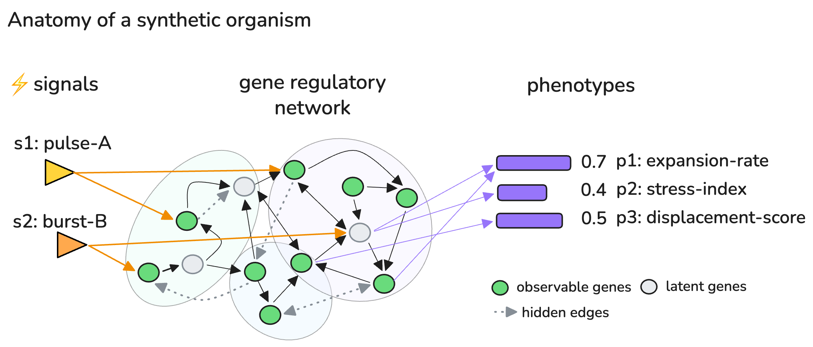

# LUCA

[](LICENSE)
[](https://www.python.org/downloads/)

**Synthetic organism reasoning benchmark for LLM agents**

A Python package that procedurally generates synthetic biological organisms (based on synthetic regulatory networks) and exposes them as a reasoning benchmark for LLM agents. Evaluated on 10 models (7 LLMs + 3 baselines) across 1,200+ sessions.

The world is **unknowable via retrieval** — gene names, module labels, signals, and pathways are all invented. Prior biological knowledge is useless. An agent must reason causally from perturbation experiments to succeed.



---

## 🧬 Design Principles

1. **Made-up vocabulary** — gene IDs e.g `G001`, modules labeled `"charge-flow-regulator"`, signals e.g`"substrate-X"`. No real gene or pathway names. Distinguishes causal reasoning from retrieval.
2. **Organism dynamics and complexity** — gene states follow `x_i(t+1) = σ(bias_i + Σ W_ij·x_j + signal_terms + ε)`, values in [0, 1] ([Mjolsness, Sharp & Reinitz, 1991](https://doi.org/10.1016/S0022-5193(05)80391-1); [Karlebach & Shamir, 2008](https://doi.org/10.1038/nrm2503)). Complexity is controlled along four axes:

   | Tier | Alias | Observability | FFL density | Feedback density | Latent genes | Noise σ | Steepness β |
   |------|-------|:---:|:---:|:---:|:---:|:---:|:---:|
   | `easy` | `prokaryote` | 80 % | 7 % | 0 % | 0 % | 0.005 | 0.7 |
   | `medium` | `simple_eukaryote` | 60 % | 13 % | 13 % | 0 % | 0.01 | 1.0 |
   | `hard` | `complex_eukaryote` | 50 % | 20 % | 27 % | 25 % | 0.03 | 2.0 |

   **`medium` is the default** and defines the canonical benchmark split (seeds 0–19). The canonical configuration uses N=20 genes, 4 modules, 3 phenotypes, 3 signals, and budget B=31. FFL and feedback densities are fractions of `n_genes`, so complexity scales with organism size. Latent genes = hidden confounders never visible or targetable. Steepness β controls sigmoid non-linearity — higher β makes dynamics harder to linearise.

   > **Easy tier note**: 3/20 easy organisms have near-linear dynamics where prediction tasks are solvable by additive approximation. This is an inherent property of low-feedback networks, reported transparently. Medium and hard are fully non-trivial (0/20 additive tasks on medium and hard).

3. **Named phenotype readouts** — non-linear summaries of an organism state e.g `"expansion-rate"` depending on gene states. The agent sees readout names and values, not raw gene states.
4. **JSON/YAML serialization** — organisms are fully serializable for reproducibility and offline evaluation.
5. **Disease mode** — organisms can be given a malfunction (LOCK_HI/LOCK_LO/PERSIST) that shifts phenotypes away from healthy ranges. Agents must diagnose and rescue.

---

## 🎯 The Task

LUCA is a benchmark for causal reasoning under a fixed experimental budget. Each session presents an agent with a freshly generated organism it has never seen — no prior knowledge applies. The agent must design perturbation experiments, build a causal model from the results, and make accurate predictions.

**The agent is given:**
- A set of observable genes and their baseline states
- Named phenotype readouts (not raw gene states)
- A budget of perturbation experiments

**The agent must:**
1. **Explore** — run experiments: BLOCK, BOOST, or DAMPEN genes, or activate signals. Each costs 1 budget unit.

   | Intervention | Effect |
   |---|---|
   | `BLOCK` | Suppress gene to 0.0 |
   | `BOOST` | Saturate gene to 1.0 |
   | `DAMPEN` | Clamp gene to ≤ 0.15 (partial suppression, distinct from full BLOCK) |
   | signal `"activate"` | Amplify signal input to targets |

2. **Predict** — answer **2 held-out prediction tasks** (configurable via `n_prediction_tasks`). Each task involves a multi-gene intervention the agent has not run directly; the agent must predict the resulting phenotype values from its causal model.
3. **Diagnose** *(disease mode)* — identify the malfunctioning gene or signal and its malfunction type (LOCK_HI / LOCK_LO / PERSIST).
4. **Rescue** *(disease mode)* — test an intervention that restores phenotypes to healthy ranges. Requires a diagnosis to be submitted first; the diagnosis score is withheld until session end.
5. **Hypothesise** *(optional, unscored)* — submit a free-text causal summary of the network for qualitative review.

**Scoring:**

| Component | Metric | Mode |
|-----------|--------|------|
| Prediction accuracy | Fraction of predictions within ±0.10 of true value (MSE reported separately) | Both |
| Diagnosis | 1.0 exact · 0.5 right target wrong type · 0.0 wrong | Disease |
| Rescue | Fraction of aberrant phenotypes restored to healthy range | Disease |

**Composite score**: healthy = prediction accuracy; disease = mean(prediction accuracy, diagnosis score, rescue fraction). In disease mode, sub-scores (pred_acc / diagnosis / rescue) are the primary reported metrics — the composite is a convenience summary.

> Prediction tasks are revealed one at a time — the agent cannot see task 2 until task 1 is submitted, so the held-out interventions cannot be run directly before predicting.

> Modules are **hidden from the agent** — inferring functional groupings is part of the challenge.

---

## ⚡ Quick Start

```bash
pip install -r requirements.txt

# Smoke test
python -c "from luca import generate_organism; o = generate_organism(seed=0); print(o.id)"
```

### demo.py — walkthrough & agent demo

```bash
python demo.py                          # narrative walkthrough (no API key needed)
python demo.py --agent                  # run an agent session; saves logs/demo_agent.{json,html}
python demo.py --agent --model gpt-4.1  # choose model
python demo.py --agent --disease        # disease mode
```

| Flag | Default | Description |
|------|---------|-------------|
| `--agent` | off | Run an LLM agent session after the walkthrough |
| `--model MODEL` | `gpt-4o` | Model to use (e.g. `gpt-4.1`, `claude-opus-4-6`) |
| `--disease` | off | Use a disease organism |

### evaluate.py — benchmark evaluation

Runs the canonical benchmark: seeds 0–19, medium difficulty. Produces aggregate scores (MSE, accuracy, composite) across organisms.

```bash
python evaluate.py --heuristic                              # no API key required
python evaluate.py --model claude-opus-4-6                  # requires ANTHROPIC_API_KEY
python evaluate.py --model gpt-5.1                          # requires OPENAI_API_KEY
python evaluate.py --model deepseek-v3                      # requires TOGETHER_API_KEY
python evaluate.py --model qwen-3.5                         # requires TOGETHER_API_KEY
python evaluate.py --model claude-opus-4-6 --model gpt-5.1  # compare models
python evaluate.py --model claude-opus-4-6 --disease
python evaluate.py --model claude-opus-4-6 --difficulty hard
python evaluate.py --model claude-opus-4-6 --tasks predict            # prediction only
python evaluate.py --model claude-opus-4-6 --tasks diagnose rescue --disease  # disease tasks only
```

| Flag | Default | Description |
|------|---------|-------------|
| `--model MODEL` | — | Model to evaluate (repeatable). Supports `claude-*` (Anthropic), `gpt-*`/`o1`/`o3`/`o4` (OpenAI), `deepseek-v3`/`qwen-3.5` (Together AI) |
| `--heuristic` | off | Include the heuristic baseline (BLOCK each gene, predict additively) |
| `--disease` | off | Evaluate in disease mode |
| `--difficulty TIER` | `medium` | `easy` / `medium` / `hard` |
| `--tasks TASK [...]` | `all` | Task components: `predict` `diagnose` `rescue` (or `all`) |
| `--n INT` | 20 | Number of organisms (uses canonical seeds 0…N-1) |
| `--seeds` | — | Override seeds: integers or range, e.g. `0 1 2` or `0:10` |
| `--out DIR` | `results/` | Output directory for JSONL results and logs |

### Bring Your Own Agent

Benchmark any custom agent — rule-based, open-source LLM, or custom framework — using the `--agent` flag:

```bash
python evaluate.py --agent my_agent.py:run --n 5
python evaluate.py --agent my_agent.py:run --disease --difficulty hard
python evaluate.py --agent my_agent.py:run --agent-name llama-3.3-70b --n 20
```

Your agent is a Python function that receives an `ExperimentSession` and interacts with it directly:

```python
# my_agent.py
def run(session) -> None:
    info = session.get_info()
    # run experiments, submit predictions, optionally diagnose and rescue
    while True:
        task = session.get_next_prediction_task()
        if task.get("done"):
            break
        session.submit_prediction(task["task_id"], {"phenotype-X": 0.5})
```

See **[docs/custom_agents.md](docs/custom_agents.md)** for the full interface, disease mode, and a worked example.

---

## 🔍 Inspector CLI

Visualise and explore individual organisms. Use `evaluate.py` for multi-seed benchmarking; use `--replay` here to run a single agent session and inspect its reasoning in detail.

```bash
# Terminal summary + interactive graph (default: seed=42, medium difficulty)
python inspect_organism.py
python inspect_organism.py --seed 7 --difficulty hard

# Figure only / terminal only
python inspect_organism.py --seed 7 --save org.png --no-show
python inspect_organism.py --no-plot

# Disease organism: terminal comparison + optional side-by-side GRN figure
python inspect_organism.py --disease --seed 7 --no-plot
python inspect_organism.py --disease --compare --seed 7 --no-show --save disease.png

# Single-organism agent session — saves JSON + HTML trace for inspection
# (for multi-seed evaluation use evaluate.py)
python inspect_organism.py --replay --seed 42 --log logs/run.json
python inspect_organism.py --replay --disease --model gpt-4o --seed 42 --log logs/run.json --trace
```

| Flag | Default | Description |
|------|---------|-------------|
| `--seed INT` | 42 | Organism seed |
| `--difficulty TIER` | `medium` | `easy` / `medium` / `hard` |
| `--disease` | off | Disease organism (terminal: healthy vs disease comparison) |
| `--compare` | off | Side-by-side healthy vs disease GRN figure (with `--disease`) |
| `--replay` | off | Run a single agent session for inspection; save JSON + HTML with `--log` |
| `--model MODEL` | `claude-opus-4-6` | Model for `--replay` |
| `--log PATH` | — | Save agent session log to JSON and generate HTML report |
| `--trace` | off | Print turn-by-turn trace after replay |
| `--save PATH` | — | Save figure to file |
| `--no-show` | off | Skip interactive plot window |
| `--no-plot` | off | Skip figure entirely |

**Programmatic usage:**
```python
from luca import generate_organism
from luca.inspect import print_organism, plot_organism

org = generate_organism(seed=42)
print_organism(org)                          # terminal
plot_organism(org, save_path="org.png")      # figure
```

---

## 📁 Package Structure

```
luca/
├── __init__.py       # Public API
├── schema.py         # Dataclasses: Gene, Module, Signal, Relation, Phenotype,
│                     #   DynamicsConfig, Organism, CellType, Malfunction
├── vocabulary.py     # Word banks for invented abstract names + cell types
├── generation.py     # generate_organism(), generate_disease_organism()
├── dynamics.py       # simulate_sigmoid(), compute_phenotypes()
├── experiment.py     # ExperimentSession — budget, interventions, scoring
├── dataset.py        # generate_dataset() — JSON export for offline benchmarking
├── agent.py          # Tool definitions + run_agent() (Anthropic, OpenAI, Together AI)
├── inspect.py        # plot_organism(), plot_disease_organism(), plot_session()
├── report.py         # print_session_trace(), export_session_html()
└── baselines/        # Non-LLM baselines
    ├── heuristic.py  # Systematic BLOCK sweep + additive prediction
    ├── random.py     # Predict 0.5 everywhere, no experiments
    └── causal_sweep.py  # Logit-space prediction (calibration baseline, uses privileged knowledge)

evaluate.py           # Benchmark evaluation script
demo.py               # Smoke tests + agent demo entry point
inspect_organism.py   # CLI inspector and replay tool
docs/                 # Design docs, results, custom agent guide
tests/                # pytest suite (50 tests)
requirements.txt
```

---

## 📖 API Reference

Full API documentation — `generate_organism()`, `generate_disease_organism()`, `ExperimentSession`, `run_agent()`, diagnostic reports, `generate_dataset()` — is in **[docs/api.md](docs/api.md)**. For custom agents and open-source model integration, see **[docs/custom_agents.md](docs/custom_agents.md)**.

---

## 📦 Dependencies

```
anthropic>=0.40.0    # Anthropic Claude API (agent loop)
openai>=1.30.0       # OpenAI API (agent loop)
numpy>=1.24.0        # Dynamics simulation
pyyaml>=6.0          # YAML serialization
rich>=13.0           # Terminal organism inspector
matplotlib>=3.7      # Plot figures
networkx>=3.0        # GRN graph layout
```

---

## 📄 Citation

If you use LUCA in your research, please cite:

```bibtex
@misc{luca2026,
  title  = {{LUCA}: A Synthetic Organism Reasoning Benchmark for LLM Agents},
  author = {Anonymous},
  year   = {2026},
  url    = {https://anonymous.4open.science/r/luca},
}
```
